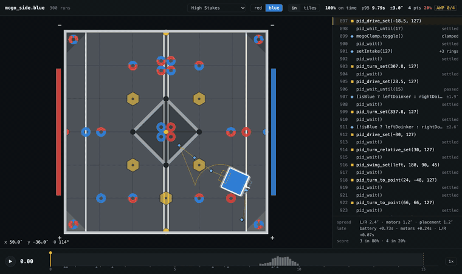
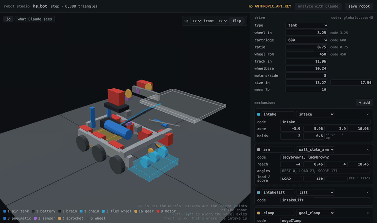
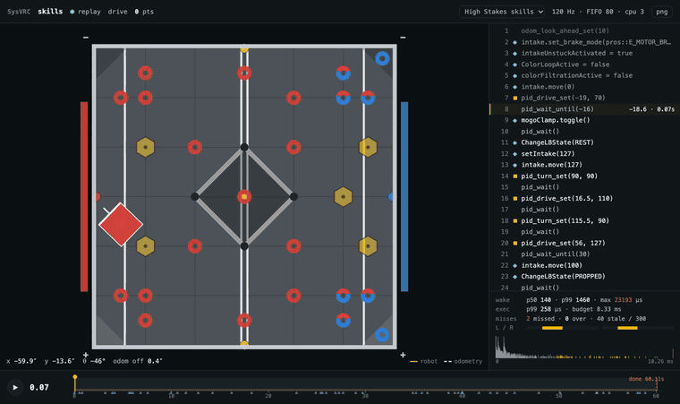

# SysVRC

Simulation and test tools for VEX V5 robots (VRC High Stakes) programmed with EZ-Template or LemLib.

| Component | Purpose |
|---|---|
| `auton_check` | Runs an autonomous routine hundreds of times through a C++ port of its drive library (EZ-Template v3.2.2 or LemLib v0.5.6) with randomized disturbances and reports what varies and why |
| Robot studio | Builds a simulation model (`robot.json`) from a robot's CAD and source code |
| ROS 2 sim | Runs the same controller on a 120 Hz real-time thread against a kinematic plant or Gazebo |



## Requirements

* C++17 compiler (CMake 3.16+ optional)
* Python 3; 3.12+ for the robot studio
* Docker for the ROS 2 sim

## Checking autonomous routines

```bash
python3 tools/auton_import.py v5/src/autons.cpp v5/src/skills.cpp --all -o autons
cmake -S core -B build/core && cmake --build build/core
build/core/auton_check autons/state_solo_awp.blue.auton --html report.html
```

Without CMake: `c++ -std=c++17 -O2 -Icore/include -Icore/tools core/tools/auton_check.cpp -o auton_check`.

The importer converts EZ-Template or LemLib code, including wrapper functions, `if (isBlue)` branches, timed pushes and same-file helpers, into `.auton` files. For LemLib, also pass the file that builds `lemlib::Chassis` (usually `main.cpp`) so the sim uses your drivetrain, PID settings and tracking wheels; see [docs/lemlib.md](docs/lemlib.md) and the project in `examples/lemlib`. Lines that depend on runtime robot state are marked `NOT IMPORTED`. Use `--bind isBlue=false` for the red side.

`auton_check` runs the routine once undisturbed, then 300 times (`--runs`) with random placement error, battery level, left/right mismatch, wheel slip, gyro drift and motor response. It reports the on-time rate, how far each mechanism call lands from its undisturbed position, and which disturbance contributes most. The HTML report plots every run on the field next to the source and marks the instruction still running at the time limit.

For one summary line per routine: `for f in autons/*.auton; do build/core/auton_check "$f" --brief; done`. Full reference: [docs/auton_check.md](docs/auton_check.md).

## Robot models

The default simulated robot is a generic 15 in drivetrain. The robot studio reads a STEP export (motors, cartridges, wheels, gears, pistons, sensors) and the robot's code (chassis constructor, motor names, helpers) and writes a `robot.json`. With `ANTHROPIC_API_KEY` set, it also uses Claude to identify mechanisms from renders and code. The result can be edited in the browser before saving.



```bash
python3 -m pip install -r tools/robot_studio/requirements.txt
python3 tools/robot_studio serve        # http://localhost:8090
build/core/auton_check autons/state_solo_awp.blue.auton --robot robots/ours/robot.json --html report.html
```

With `--robot`, the report also simulates game elements: rings, goal clamps (with miss distance), wall stakes, the final score and the autonomous win point. path.jerryio paths can be imported with `tools/path_import.py`. See [docs/robot_studio.md](docs/robot_studio.md).

## ROS 2 simulation

The workspace builds and runs in a Linux container, including on Apple Silicon.

```bash
docker compose -f sim/docker/compose.yaml build
sim/tools/build.sh

# kinematic plant, no Gazebo (used in CI)
docker compose -f sim/docker/compose.yaml run --rm --service-ports sim \
  ros2 launch visbot_control plant.launch.py mission:=state_solo_awp.blue cpu:=3 poll_idle:=true spin_us:=500

# Gazebo
docker compose -f sim/docker/compose.yaml run --rm --service-ports sim \
  ros2 launch visbot_gazebo sim.launch.py mission:=worlds_mogo_rush.blue cpu:=3 poll_idle:=true spin_us:=500
```

The dashboard at http://localhost:8080 shows the true and estimated pose, wait exit conditions, the match clock and loop latency. `robot:=robots/<name>` loads a studio robot. Launch arguments: [docs/architecture.md](docs/architecture.md#launch-args).



To replay the recorded Gazebo skills run without ROS:

```bash
cp docs/replay/skills_gazebo.jsonl sim/src/visbot_dash/web/ && (cd sim/src/visbot_dash/web && python3 -m http.server 8080)
# open http://localhost:8080/?replay=skills_gazebo.jsonl
```

## Repository layout

| Path | Contents |
|---|---|
| `core/` | Header-only C++17 drive control (EZ-Template and LemLib ports), plant model, `auton_check` |
| `autons/` | Routines as `.auton` files, generated from `v5/src` |
| `robots/` | `robot.json` models |
| `tools/` | `auton_import.py`, `path_import.py`, `build_web.py`, robot studio |
| `web/` | Report page, field drawing, game element sim |
| `sim/` | ROS 2 packages: control loop, Gazebo model, dashboard |
| `v5/` | PROS competition code (EZ-Template) |
| `examples/` | A LemLib project and its imported routines |
| `docs/` | Design notes, EZ-Template fidelity, latency |

* Both ports keep their library's quirks on purpose; they are listed in [docs/fidelity.md](docs/fidelity.md) (EZ-Template) and [docs/lemlib.md](docs/lemlib.md). EZ gains in `constants.hpp` mirror `default_constants()`; LemLib settings come from the routine file.
* `autons/` and `core/tools/report_template.hpp` are generated and committed. CI fails if either is stale; regenerate with the importer and `python3 tools/build_web.py`.
* `v5/` is missing `include/` and `project.pros`, so `pros make` does not work from a fresh clone.

## Testing

```bash
cmake -S core -B build/core && cmake --build build/core && ctest --test-dir build/core --output-on-failure
python3 -m unittest discover -s tools/tests
python3 -m unittest discover -s tools/robot_studio/tests
node --test web/tests/*.test.js
docker compose -f sim/docker/compose.yaml run --rm sim bash -lc "colcon test && colcon test-result --all"
docker compose -f sim/docker/compose.yaml run --rm sim src/sysvrc/sim/tools/smoke_test.sh 24 state_solo_awp.blue fifo 3 true 500
docker compose -f sim/docker/compose.yaml run --rm sim src/sysvrc/sim/tools/gazebo_smoke.sh 30 square 6.0
```

CI runs all of these on every push.

## Latency

Wake latency of the 120 Hz loop (`rt_bench`) in Docker Desktop on macOS. The VM's ~3 ms timer resolution dominates, so compare rows rather than reading absolute values. Details in [docs/latency.md](docs/latency.md).

| Setup | p50 | p99 | Max | Missed |
|---|---:|---:|---:|---:|
| SCHED_OTHER + 8 CPU hogs | 2720 µs | 6060 µs | 32783 µs | 8 |
| SCHED_FIFO 80 + 8 hogs | 2640 µs | 5160 µs | 7763 µs | 0 |
| FIFO + pinned + poll-idle | 360 µs | 700 µs | 1070 µs | 0 |
| FIFO + pinned + poll-idle + 500 µs spin | 20 µs | 260 µs | 659 µs | 0 |

## Troubleshooting

| Problem | Fix |
|---|---|
| "pushes with drive_set" (or `tank()`) warning | The start pose is (0, 0), so wall positions are unknown. Drag the robot to its start in the report and rerun with the `--field-start` it shows. |
| `NOT IMPORTED` in a routine | The line depends on runtime state; results after it are unreliable. |
| `pthread_setschedparam ... failed` | Run through `compose.yaml`, which grants `SYS_NICE` and the rtprio/memlock limits. |
| Millisecond latency on macOS | Expected in the VM. Use `cpu:=3 poll_idle:=true spin_us:=500`. |
| Dashboard does not load | Add `--service-ports`. |
| Routine never starts | The controller waits for `/visbot/imu` and `/visbot/joint_states`. "no routine called" means the name is not in `autons/`. |
